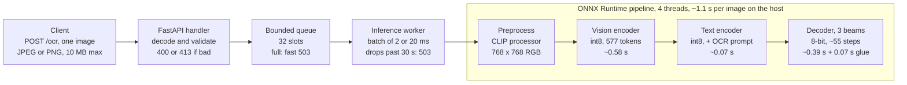

# Performance design

The Florence-2 OCR backend now serves one image in 0.94 s (p50) and sustains 1.06 requests/s on 4 CPUs
within 2.1 GB of RAM. Its text matches the original PyTorch model exactly. Those figures come from Docker
runs on 2026-11-10 (`--memory=4g --cpus=4`), logged in `journal.md`. Design decisions and their reasons
are in `DESIGN.md`.

## Overview

**System:** a CPU-only OCR API built on `microsoft/Florence-2-base` (revision `5ca5edf`). It takes an
image and returns the text of the `<OCR>` task.

**Goals**

- Lowest single-request latency and highest requests/s possible on CPU.
- Accuracy at 70% or more against the original model's output.
- Run inside 4 GB of RAM, with a few CPU threads and no GPU.

**Non-goals**

- GPU serving, response caching (every request runs inference), and tasks other than `<OCR>`.
- PyTorch in the server. It runs only offline, in `export/`.

## Performance requirements

The service meets every hard limit today. Accuracy has only been checked on 6 synthetic images, so that
result is not final.

| Dimension | Metric | Requirement | Current (Docker, 4 CPUs) | Status |
| --- | --- | --- | --- | --- |
| Time | Single-request latency, p50 | As low as possible | 0.94 s | Measured |
| Time | Single-request latency, p95 / p99 | Report both | Not logged yet | Open |
| Time | Startup until `/health` returns ok | ≤ 120 s | ~3 s | Met |
| Time | Request deadline | 200 within 30 s, or it counts as failed | Requests that can't finish in 30 s are dropped with a 503 | Met |
| Accuracy | Mean of max(0, 1 − CER) against the reference text | ≥ 70% | 100% on 6 synthetic images | Recheck on real samples |
| Accuracy | Text vs PyTorch output | Identical | Identical, single and batched | Met |
| Workload | Max sustained RPS at ≥ 99% success | As high as possible | 1.06 RPS | Measured |
| Workload | 10-minute soak at concurrency 4 | No errors, no leak | 628 requests, 100% success, memory flat at ~1.98 GB | Met |
| Resources | Peak container memory | < 4 GB | 2.12 GB (MAX_BATCH 2), 1.36 GB (MAX_BATCH 1) | Met |
| Resources | Image contents | No `torch` | Checked | Met |

Accuracy comes first. Greedy decoding was 0.11 s faster, but 3-beam search stays because it matches the
reference model's settings.

## Architecture and request path

One inference worker thread runs every request, because ONNX Runtime already uses all allowed cores
inside one run. The handler rejects bad input before it ever reaches the queue. The vision encoder is
about half of every request.

## Endpoint performance

`POST /ocr` carries all of the cost: about 0.94 s per image, and 1.06 RPS at most. `GET /health` does no
model work. Both listen on port 8000.

### POST /ocr

Input is `multipart/form-data` with one `image` field (JPEG or PNG). Output is `{"text": "..."}`.

| Measure | Value |
| --- | --- |
| Latency, p50 (sequential, after warm-up) | 0.94 s |
| Latency, p95 / p99 | Not logged yet: `bench/latency.py` prints them, but the journal only kept p50 |
| Latency, p50 at concurrency 4 | ~5 s (4.9 s at MAX_BATCH 1, 5.4 s at MAX_BATCH 2), measured before the decoder surgery |
| Max throughput | 1.06 RPS at ≥ 99% success |
| Sustained throughput | 1.04 RPS for 10 minutes at concurrency 4, 0 errors |
| Hard deadline | 30 s. A request that can't finish in time gets a 503 and is not run |
| Queue | 32 slots. When full, a 503 comes back right away instead of waiting |
| Batching | Up to MAX_BATCH = 2 images, or after MAX_WAIT_MS = 20 ms, whichever comes first |
| Accuracy | 3-beam search; text identical to the PyTorch model |

Where the time goes in one request (host, 4 threads, after all optimizations):

| Stage | Time | Note |
| --- | --- | --- |
| Vision encoder (int8) | ~0.58 s | About half of a request; close to its floor on ORT CPU |
| Text encoder (int8) | ~0.07 s | |
| Decoder, ~55 steps (8-bit) | ~0.39 s | Was 0.88 s before the graph surgery |
| NumPy beam-search glue | ~0.07 s | Was 0.65 s before the cross-attention cache fix |

These four add up to about 1.1 s on the host. The 0.94 s p50 is the Docker measurement, so the two runs
differ.

Error responses (none of them run inference):

| Status | When |
| --- | --- |
| 400 | Missing `image` field, or not a valid JPEG/PNG |
| 413 | Upload larger than 10 MB |
| 503 | Model still loading, queue full, or the 30 s deadline can't be met |
| 500 | Inference raised an error (logged) |

### GET /health

Returns `{"status": "ok"}` once the model is loaded, and `{"status": "loading"}` with a 503 before that.

| Measure | Value |
| --- | --- |
| Latency | Milliseconds. It only checks a flag, never touches the model or the queue (not benchmarked) |
| Time to ok after container start | ~3 s (limit 120 s) |
| Under load | Stays responsive: inference runs on a separate worker thread, not the event loop |

## Workload model and capacity

One container handles about 1 image per second. Throughput can only grow with more CPUs or more
containers, because batching adds none on 4 CPUs.

**Traffic profile (the challenge's load test):** concurrency rises step by step (1, 2, 4, 8, …). Each
client sends requests back to back, and the official run uses 2-minute steps. A step passes at ≥ 99%
success, where success is a 200 with text within 30 s.

**Request cost:** every request runs the full pipeline, with no cache. One image is 577 image tokens plus
10 prompt tokens, and about 55 decoder steps across 3 beams. A batch of N images is therefore 3N decoder
rows, and those rows drive RAM.

**Batch size vs memory** (host, 16 threads, before the later optimizations):

| Batch | Peak RAM | Images/s |
| --- | --- | --- |
| 1 | 2.4 GB | 0.31 |
| 2 | 2.7 GB | 0.34 |
| 4 | 3.8 GB | 0.39 |
| 8 | 6.8 GB | 0.40 |

Batch 4 comes too close to the 4 GB limit, and batch 8 goes over it. On 4 CPUs, batch 2 takes exactly
twice as long as batch 1.

**Capacity rules of thumb**

- Queue of 32 at ~1 RPS means a full queue holds about 30 s of work. That matches the deadline, so
  anything beyond it gets a 503 instead of a timeout.
- One process with all threads beats 2 processes × 2 threads on latency (0.94 s vs 1.34 s p50). The
  latter gains only 7% RPS (1.13 vs 1.06).
- Scale out with more containers, each with its own CPU quota. Within a container, set `ORT_THREADS` to
  the quota, which is the default.

## Testing methodology

Every change goes through one rule: change one thing, measure accuracy, latency and load in Docker, then
keep it or revert it. Each result gets a row in `journal.md`. `bench/docker_bench.sh` runs all three under
the official limits (`--memory=4g --memory-swap=4g --cpus=4`) and reports peak container memory.

| Test | Script | What it measures | Pass criterion |
| --- | --- | --- | --- |
| Accuracy | `bench/accuracy.py` | Per image max(0, 1 − CER) against `references/`, averaged | ≥ 70% |
| Exactness | `export/check_pipeline.py` | ONNX pipeline text vs PyTorch, single and batched | Identical text |
| Latency | `bench/latency.py` | Sequential requests after 3 warm-ups; p50 / p95 / p99 | Lower than the previous kept row |
| Load | `bench/load.py` | RPS at rising concurrency (1, 2, 4, 8) | Highest RPS of a step with ≥ 99% success |
| Soak | `bench/load.py`, 10 min | Errors and memory over time at concurrency 4 | 0 errors, flat memory |
| Stage profile | `bench/profile_stages.py`, `bench/ort_profile.py` | Time per graph and per ONNX op | Diagnostic only |
| Bad input | Manual `curl` cases | Oversized, missing, corrupt uploads | 4xx, no crash |

The reference text is currently our own PyTorch output on 6 synthetic images, because the starter repo
isn't out yet. Quantization (int8 encoders, 8-bit decoder) has to be rechecked on the real samples once
they arrive.

## Monitoring and alerting

Today the server only writes logs: the startup settings line (threads, spinning, beams, int8 graphs) and
any inference exception. The metrics and thresholds below are proposed, not built.

| Signal | Source | Proposed alert |
| --- | --- | --- |
| `/ocr` latency p50 / p95 | Request timing in the handler | p95 > 3× the benchmark p50 for 5 min |
| Queue depth | `worker.jobs.qsize()` | > 24 of 32 for 1 min |
| 503 rate (queue full + deadline drops) | Handler and worker | > 1% of requests over 5 min |
| 500 rate | Worker exception path | Any |
| Batch time | `worker.last_batch_s` | > 10 s |
| Container memory | `docker stats` / cgroup | > 3.5 GB |
| `/health` | External probe | Not ok for 30 s after startup |

## Optimizations, risks and open questions

Five kept changes took p50 from 9.1 s to 0.94 s and RPS from 0.17 to 1.06. The biggest remaining risk is
accuracy on real images.

**Kept optimizations** (Docker, 4 CPUs)

| Change | p50 | Max RPS |
| --- | --- | --- |
| Baseline: fp32, ORT default threads | 9.1 s | 0.17 |
| ORT threads = CPU quota | 3.5 s | 0.36 |
| int8 encoders + 8-bit decoder | 2.5 s | 0.50 |
| No per-beam cross-attention cache gathers | 2.3 s | 0.56 |
| ORT spinning off | 1.2 s | 0.81 |
| Decoder graph surgery (no per-step Transpose / Identity) | 0.94 s | 1.06 |

**Trade-offs taken**

- 3-beam search instead of greedy: +0.11 s p50 and −12% RPS, in exchange for matching the reference text.
- Max new tokens 1024: no text ever gets cut, but long pages set the worst-case latency.
- Input fixed at 768×768: text already changes at 640, and whole lines go missing at 512.

**Risks**

- Dynamic int8 on the vision encoder is the noisiest variant (mean diff 0.147 vs fp32). It is the first
  suspect if accuracy drops on real samples.
- int8 speedups depend on AVX-VNNI on the development CPU. The evaluation CPU may not have it.
- CPU count is a stand-in (4) until the official number is announced. Thread and batch choices must be
  re-measured on it.
- Preprocessing uses the built-in `CLIPImageProcessor` on the strength of a verbal waiver. That waiver
  needs to be in writing.

**Open questions**

- [ ] MAX_BATCH 1 or 2? Batch 1 gives the same RPS (0.83 vs 0.81), better latency and 1.36 GB vs 2.12 GB.
- [ ] Tune MAX_WAIT_MS (now 20 ms) and QUEUE_SIZE (now 32).
- [ ] Cap max new tokens below 1024 as a latency safety limit?
- [ ] Log p95 / p99 for `/ocr` in every journal row.
- [ ] Re-run accuracy and latency on the real samples and the official CPU count.
